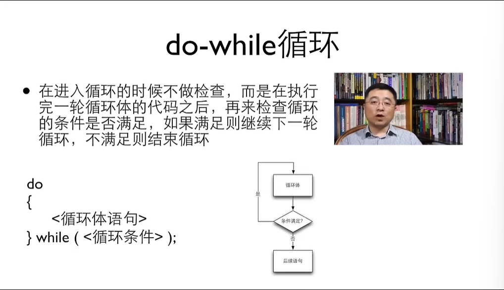

# C的学习笔记
## 运算符优先级
1. 单目运算最高，自右向左
>a*+b a*-b先做-b再做*
2. 赋值是运算符，他有结果，且自右向左
3. 所有的关系运算符的优先级比算数运算的低，但是比赋值运算的高
## 交换变量
1. 找第三个变量
2. 断点是程序在调试时走到这就停下来
## 复合赋值
1. += -= *= /= %=  e.g.count+=1 等价 count=count+1
2. i++ 等价i+=1单目运算符且算子是变量
3. ++或--也可放于变量之前，都是使变量自增或自减，但是a++先办事后自增，++a先自增后办事
4. ++--可以单独使用不要写进组合表达式
## 条件判断
1. if(条件)  {  }  else  {  }
2. 当两个值的关系符合关系运算符的预期时，关系运算的结果为整数1，否则为0
3. 判断是否相等的==和！=的优先级比其他的低，而连续的关系运算是从左到右进行
4. 注释：单行用//  多行用/* */
5. else总是和最近的那个if匹配（如果没加大括号）
6. 在c里面缩进格式不能暗示else的匹配
7. 级联if( ) { } else if( ) { } else { }
8. switch(变量或表达式，都是整型才可)
   {
    case 值1:  
        执行的语句；
        break;
    case 值2:  
        执行的语句；
        break;
    default:
        执行的语句；
        break;  
    }
9. 如果没有break，则执行完case后，会继续执行下一个case，直到遇到break或者case的结束
10. 代码应符合单一出口原则
## 循环
1. while(条件)  { 循环体 }
2. 循环体内要有改变条件的机会，否则会死循环
3. 可以通过人脑模拟计算机程序运行，列表即可
4. 可通过在程序中插入printf去代替debug
5. do-while循环：
6. for循环：for(初始化;条件;迭代)  { 循环体 }
7. 循环体做完再迭代。
## 二维数组
1. int a[3][5]   a是一个三行五列的数组
2. 遍历
3. 列数不可以省略，行数可以
4. 有省略就补零
5. 数组名加下标就是变量
6. 